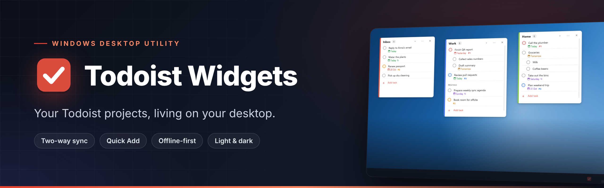
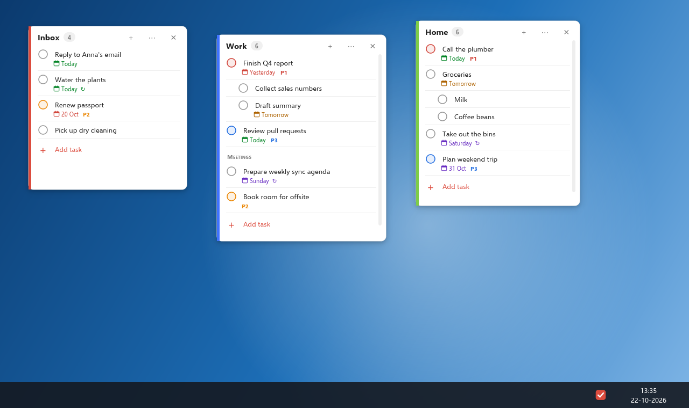
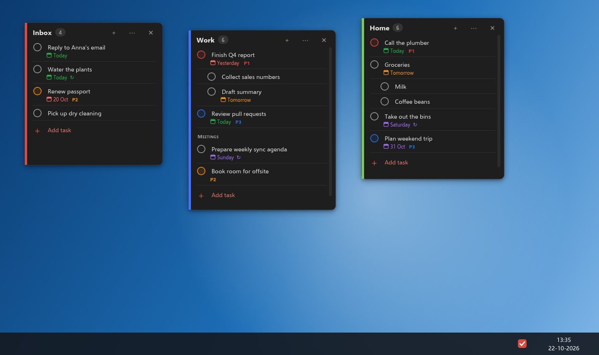
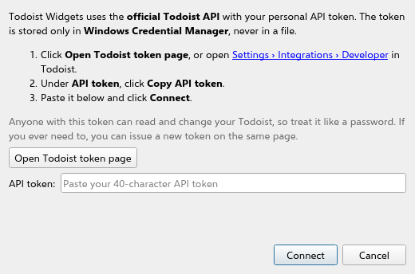
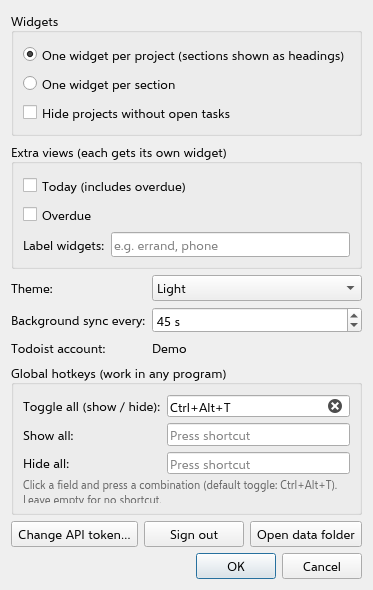
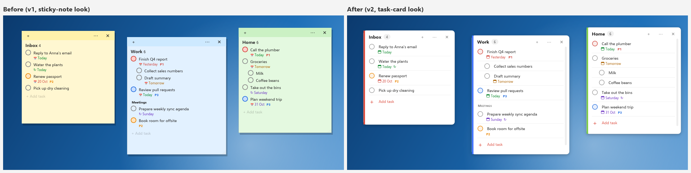

  

  
  
  
  
  

<h3 align="center">Your Todoist projects as always-visible task cards on the Windows desktop — tick, add and edit without opening an app.</h3>

  <a href="#-quick-start">Quick start</a> ·
  <a href="#-features">Features</a> ·
  <a href="#-hotkeys">Hotkeys</a> ·
  <a href="#-configuration">Configuration</a> ·
  <a href="#-faq--troubleshooting">FAQ</a> ·
  <a href="#-roadmap">Roadmap</a> ·
  <a href="#-pro--coming-soon">Pro</a>

---

## ✨ Features

<table>
<tr>
<td width="33%" valign="top">

### 🗂️ One card per project
One widget per project — or per section — with the Todoist project colour as an accent bar. Extra cards for **Today**, **Overdue** or any **@label**.

</td>
<td width="33%" valign="top">

### 🔄 Real two-way sync
Built on the **official Todoist API v1** with incremental sync. Changes on your phone show up on the desktop, and vice versa.

</td>
<td width="33%" valign="top">

### ⚡ Quick Add built in
Type `Call Anna tomorrow 10am p1 #Work @phone` — Todoist itself parses dates, priorities, projects and labels.

</td>
</tr>
<tr>
<td valign="top">

### ✍️ Edit in place
Tick tasks off, rename them inline, delete with one click. Sub-tasks, sections, recurring tasks and due-date chips all render natively.

</td>
<td valign="top">

### 📴 Offline-first
Tasks are cached locally and edits are queued with unique command IDs, so nothing is lost or applied twice when the network drops.

</td>
<td valign="top">

### 🎨 Light & dark themes
Clean rounded cards with a soft shadow, Todoist's own colour palette, per-widget accent colours and always-on-top control.

</td>
</tr>
<tr>
<td valign="top">

### ⌨️ Global hotkeys
**Ctrl+Alt+T** shows or hides every widget from any program. Separate Show / Hide shortcuts are optional.

</td>
<td valign="top">

### 🔐 Secure by design
Your API token lives only in **Windows Credential Manager** — never in a file, never in a log.

</td>
<td valign="top">

### 🪶 Lightweight
A tray app with no Electron and no background browser. Starts in a second, syncs every 45 s.

</td>
</tr>
</table>

## 📸 Screenshots

<table>
<tr>
<td align="center" width="50%"> Connect in 30 seconds with your API token</td>
<td align="center" width="50%"> Views, theme, sync interval and hotkeys</td>
</tr>
</table>

Before / after: from sticky notes to task cards

> All screenshots use demo data.

## 🚀 Quick start

**Requirements:** Windows 10/11 and Python 3.11+ with the `py` launcher (`winget install Python.Python.3.12`).

1. **Download** or clone this repository.
2. **Double-click `install.bat`.** It creates a private `.venv`, installs the pinned dependencies (PySide6-Essentials, requests, keyring) and adds a **Todoist Widgets** Start Menu shortcut.
   - `install.bat /startup` also starts the app with Windows; `install.bat /quiet` skips all questions.
3. **Start it** from the Start Menu or with **`run.bat`** (no console window).
4. **Connect Todoist:** open *Todoist → Settings → Integrations → Developer*, click **Copy API token**, paste it and click **Connect**.

Prefer your system Python? `py -m pip install -r requirements.txt` and use `run.bat`.
Just want to look around? `run.bat --demo` runs with sample data and no account.

## ⌨️ Hotkeys

| Action | Default | Where to change |
|---|---|---|
| Toggle all widgets (hide if any is visible, otherwise show all) | **Ctrl+Alt+T** | Settings → Global hotkeys |
| Show all widgets | — (optional) | Settings → Global hotkeys |
| Hide all widgets | — (optional) | Settings → Global hotkeys |
| Save an inline edit / cancel it | **Enter** / **Esc** | — |

A shortcut needs two modifiers (e.g. Ctrl+Alt+…), a Win-key combination or F13–F24. If another program already owns it, Settings tells you and the shortcut stays inactive until you pick another.

## 🛠 Configuration

Everything is set from the tray icon → **Settings…**

| Setting | Options |
|---|---|
| Widgets | One per project (sections as headings) · one per section · hide empty projects |
| Extra views | Today (incl. overdue) · Overdue · one widget per label |
| Theme | Light (default) · Dark |
| Background sync | 30–600 s (default 45 s), plus ~1.5 s after each edit |
| Per widget (⋯ menu) | Accent colour · show completed (last 14 days) · always on top |
| Start with Windows | Tray menu toggle (shortcut in `shell:startup`) |

**Files** — all per user, nothing next to the app:

| Path | Contents |
|---|---|
| `%APPDATA%\TodoistWidgets\layout.json` | Widget positions, sizes and settings |
| `%APPDATA%\TodoistWidgets\state.json` | Offline cache and queued edits (no token) |
| `%APPDATA%\TodoistWidgets\todoistwidgets.log` | Log file |
| Windows Credential Manager → `TodoistWidgets` | Your API token |

## ❓ FAQ & troubleshooting

<b>Nothing happens when I start the app</b>

Look at `%APPDATA%\TodoistWidgets\todoistwidgets.log`. A missing package shows a message box and logs `ERROR Startup failed`. An incomplete `.venv` (interrupted install) is skipped automatically — run `install.bat` again or delete `.venv` to use your system Python.

<b>Ctrl+Alt+T types a character / AltGr behaves oddly</b>

Windows treats **AltGr as Ctrl+Alt**. On keyboard layouts such as US-International, a global Ctrl+Alt+T also catches AltGr+T. If you use AltGr to type special characters, choose another combination in Settings (e.g. Ctrl+Alt+Shift+T or Win+Alt+T).

<b>Is this an official Todoist product?</b>

No. It uses the official, public Todoist API with your personal token, but it is not created by, affiliated with or supported by Doist.

<b>What happens when I'm offline?</b>

You keep seeing the cached tasks and can keep editing. The tray icon shows an orange pause badge and each widget shows how many changes are waiting. They are sent as soon as Todoist is reachable again. Conflicts resolve as *last write wins* and are logged.

<b>What isn't shown?</b>

Descriptions, comments, reminders, deadlines, durations and assignees are left untouched in Todoist. Saved filters and archived projects are not supported yet.

<b>How do I uninstall?</b>

Quit from the tray and run `uninstall.bat` (removes shortcuts and `.venv`). To remove everything, also delete `%APPDATA%\TodoistWidgets` and the `TodoistWidgets` entry in Credential Manager. Your tasks stay in Todoist.

## 🗺 Roadmap

- [ ] Saved Todoist filters as widgets
- [ ] Task descriptions and comments on hover
- [ ] Drag & drop to reorder or move tasks between projects
- [ ] More themes and a compact density mode
- [ ] Signed single-file installer (no Python required)
- [ ] Auto-update

## 💎 Pro — coming soon

> **Not available yet.** A Pro edition is being planned. Pricing and release date will be announced later.

Candidate Pro features: a signed one-click installer without Python, extra themes, filter widgets, multi-monitor layouts and priority support. Interested? Watch this repository for updates.

## 📄 License

Proprietary software — **Copyright (c) 2026 GaryHman. All rights reserved.** See [LICENSE](LICENSE).

Todoist is a trademark of Doist. This project is not affiliated with Doist.
